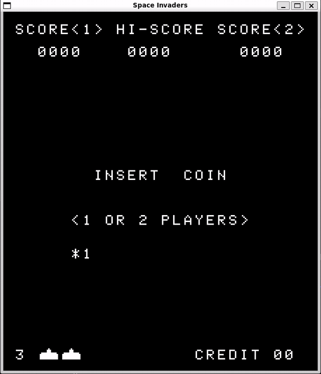

# Project Overview
Space Invaders Emulator Personal Learning Project!

Written in C, following guidance from [Emulator 101](https://emulator101.mirror.simoni.dev) to generate the CPU, and then a whole host of other sources to fumble together the hardware/display code (much of which from [Computer Archeology](https://computerarcheology.com/Arcade/SpaceInvaders)).

No AI used to code, as this was a personal learning project, though I did use GPT-6 Luna as a tutor to help me understand what graphics/sound libraries to use and how to get them set up.

# Installation
This was built off the Windows Substation for Linux, so if you're on Debian/Ubuntu you should just need to install the dependencies:

`sudo apt install build-essential pkg-config libsdl2-dev libsdl2-mixer-dev`

And then in the project root run `make run-emulate`.

It's likely there's something similar for macOS but I have neither tested it nor even really looked into it all that hard.

Maybe one day I'll make some updates to the project to build on a Windows OS; that day is not today.

# Controls
| Action        | Button    |
| :---          | :----:    |
| Credit        | Enter     |
| 1-Player Game | 1         |
| 2-Player Game | 2         |
| Tilt          | Tab       |
| P1 Left       | A         |
| P1 Right      | D         |
| P1 Shoot      | W         |
| P2 Left       | Left Key  |
| P2 Right      | Right Key |
| P2 Shoot      | Up Key    |

# Architecture

### CPU
An Intel 8080 CPU, the brain of the ordeal. Built with a great deal of assistance from [Emulator 101](https://emulator101.mirror.simoni.dev). All documented 8080 instructions implemented, and (to the best of my knowledge and testing) working as expected. Cycles are stored for each opcode, in order to determine when to schedule the interrupt which updates the display frame.

### Display & Video
Set using SDL2 graphics library. The `display.c` file encapsulates the functions used to get the window set up, while `video.c` is used to handle some specific video translation functionality (the display info is rotated 90 degrees counter-clockwise from how it's set up in memory).

### Space Invaders Machine
Used as the central mechanism which houses all the other interfaces (CPU, A/V, etc.) as well as a number of specific hardware that the Space Invaders cabinets had installed to work alongside the CPU, like the shift register.

### IoBus
Interface which the CPU's IN and OUT opcodes utilize to read information from and write information to the Space Invaders machine.

### Interrupt Scheduler
Takes in the cycle information from the CPU and determines when the emulation should inject an interrupt to update the display frame.

### Audio
The things what make the beeps and boops. Set up using SDL2 Mixer library.

# Testing
The project contains a series of (honestly ad-hoc) tests I wrote to make sure the section in question was working as I was expecting, and continued to work as expected with refactors and changes and integrations coming into place. The testing is not comprehensive.

The CPU was also directly tested using the `cpudiag.bin` located in the `/rom/` folder. It is an Official Microcosm Associates test file designed to ensure that the instructions in the CPU are working as intended; if it's working its test will output 'CPU IS OPERATIONAL', if it's not working it'll output 'CPU HAS FAILED! ERROR EXIT='. In order to get this up and working some test code was implemented into the CPU code itself, which is ugly and smelly and just what one can expect from a fun personal project like this.

Each test can be run individually with Make using `make test-<test>`. You can also run all of them in sequence using `make test-all`. Some of the tests, specifically those to do with audio and video, are not automatic, and will require you to either hit a button to continue or close a display window.